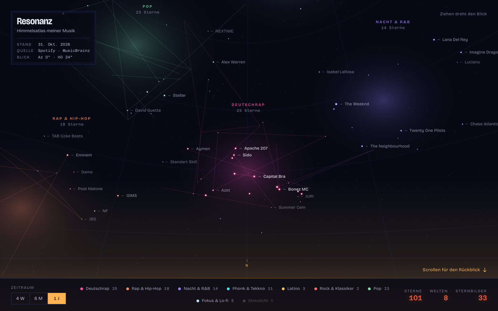

# Resonanz

**Your music as a walkable night sky.** Every artist is a star, every listening world a galaxy, and scrolling takes you through your own retrospective. Built from the Spotify Web API and MusicBrainz, rendered in the browser with three.js. No build step, no server, nothing uploaded.

[Deutsche Fassung](README.de.md) · Live: **[stefanpaun.page/resonanz](https://stefanpaun.page/resonanz/)**



## What you see

- **The sky.** ~200 stars, sized by how much you listen, haloed in the colour of their world. Artists who share songs are joined by constellation lines. Drag to look around, arrow keys work too, `Enter` opens the star nearest the centre.
- **Eight worlds.** German rap, Rap & hip-hop, Night & R&B, Phonk & techno, Latin, Rock & classics, Pop, Focus & lo-fi (plus "stray light" for the unclassifiable). The mapping from MusicBrainz tags lives in [`public/welten.js`](public/welten.js) and is tested.
- **The instrument panel.** Period switch (4 weeks · 6 months · 1 year) with an amber cursor, a legend that filters the sky, red-light readouts that follow the period.
- **The retrospective.** Scroll chapters: your worlds, what's new, the ever-burning, what faded, where the sound comes from; with your own account also release years and what you played last. All text is generated from the data.
- **Star cards.** Tap a star or a name: ranks, genres, origin and a link to the artist on Spotify. In your own sky the card also lists your top songs with length. No cover art and no audio previews (see Licences).
- **German and English.** The interface follows your browser language; the `EN`/`DE` switch in the cartouche (or `?lang=en`) overrides it.
- **Your own sky.** Drop the ZIP of your Spotify *Extended Streaming History* for an hour-by-weekday heatmap, months, night share and streaks. Or sign in with your own Spotify app (PKCE, in the browser). Everything stays in `localStorage`.
- **More sources.** The same history chapters work with an Apple Music *Play Activity* CSV, a Last.fm export (CSV or `user.getRecentTracks` JSON) and `watch-history.json` from Google Takeout (YouTube Music entries only). The source is recognised from the content, not the file name. Readers live in [`public/quellen/`](public/quellen/) as pure modules around one shared entry format (`t` in UTC, artist, title, optional album and listening time, source); sources without listening time count 3.5 minutes per entry. Files are capped at 150 MB / 3 million rows and read in chunks with a progress line. Nothing is uploaded; test fixtures are invented.
- **Stories from the history.** Three more chapters appear with a history: *Discoveries* (per month the new artist with the most minutes in its first 30 days, and whether it was still played six months later or fizzled), *Streaks* (longest run of consecutive days per artist and with any music at all, by local calendar day) and *Comebacks* (artists back after more than 180 silent days, biggest return first). Plays under 30 s don't count; thresholds are named constants in [`public/geschichten.js`](public/geschichten.js), and a chapter stays hidden when the history is too small. One extra pass over the streams (test: 300,000 entries in under a second). Gaps of more than 30 days without any music don't count as a break.

## Run it

```bash
git clone https://github.com/Stefan-Paun/resonanz
cd resonanz
npm start          # python3 -m http.server 8742 --directory public
npm test           # node --test, no dependencies
```

Open `http://127.0.0.1:8742/`. The demo uses the frozen snapshot in `data/snapshot.json` (mine, from 31 Oct 2026).

## Compare two skies

"Your own sky" → *Compare two skies* exports your sky as a small file (`resonanz-vergleich.json`, format version 1) and lays someone else's file over yours. Shared artists glow in a third colour; the three groups also differ by shape (circle: only you, diamond: only the other, square: both). A switch shows A, B or both, the chapter "The two of you" lists the numbers, and *End comparison* brings your own sky back without reloading.

- **The file holds only aggregates:** artist ids and names, weights per period (4 weeks, 6 months, 1 year), up to eight genres per artist, a weighted genre list, the month of the snapshot and a free-text display name. No listening times, no account id, no links, no songs. A test checks the exported fields against an allow-list (`ERLAUBTE_FELDER` in [`public/austausch.js`](public/austausch.js)).
- **Strict import:** version, types, size (256 KB) and counts are checked, unknown fields are dropped, control characters and angle brackets are stripped, names are shown via `textContent` or escaped. The other file stays in memory; only the checked copy is stored, and only if you tick "remember" (and is re-checked on every read).
- **The match** ([`public/vergleich.js`](public/vergleich.js)) is the mean of two cosine similarities, over artist weights and over genre weights, both also shown separately. Artists are matched by id, otherwise by normalised name. Lists: shared, only A, only B, bridges (different artists, same genre). Identical skies give 100 %, disjoint ones 0 %, and swapping A and B changes nothing.

## Accessibility

Everything the sky shows is also available as a **list view**: calm, linear, no WebGL. The *Mode: Sky / List* switch in the cartouche toggles it; the browser remembers the choice (`localStorage`), and `?ansicht=liste` or `?ansicht=himmel` in the address always wins.

- **Automatically** the list starts when the browser has no WebGL, when the graphics context is lost and does not come back within three seconds (then for the current session), or when the system asks for *reduced motion*. A note says why, with an *Open the sky anyway* button. The decision is a pure, tested function (`ansichtWaehlen` in [`public/listendaten.js`](public/listendaten.js)).
- **Content:** every artist in a table (rank, weight, world, rank per period, linked artists) with sortable columns (buttons in the column headers, `aria-sort`) and a search by name, world or country whose hit count is announced in an `aria-live` region. Below, the worlds as sections and the retrospective with the same chapters, texts and numbers as the sky. Names open the star card. Your own sky, listening history and comparison work the same way.
- **One source:** list and sky compute from the same functions in `daten.js`; the list never loads `app.js` or three.js (entry point [`public/start.js`](public/start.js)).
- **Form:** a real heading hierarchy (one h1, parts h2, worlds and chapters h3), skip links, visible amber focus. At 320 px width or 200 % zoom table rows become blocks and nothing scrolls sideways. Text contrast (at least 4.5:1) and the field border (3:1) are recomputed from `style.css` in the tests.

## Refresh the snapshot (owner)

```bash
export SPOTIFY_CLIENT_ID=...          # from developer.spotify.com, never committed
python3 tools/sammeln.py login        # PKCE login in the browser, token stays in tools/token.json (gitignored)
python3 tools/sammeln.py              # Spotify top items + MusicBrainz tags → data/snapshot.json
```

The collector is standard-library Python. MusicBrainz is queried at one request per second with a local cache; artists it does not know get their tags from `data/ueberschreibungen.json`.

## Honest limits

- Since February 2026 the Spotify Web API in development mode gives **no genres, no popularity and no previews**, the app owner needs Premium, and at most five users can be allowlisted. That is why genres come from MusicBrainz, why there are no previews, and why "sign in with your own account" needs your own client ID.
- "Recently played" is the last 50 tracks. A real daily rhythm needs the exported streaming history.
- The sky is a snapshot, not a live view.

## Privacy

The demo shows my artists and listening weights, less than a public Spotify Wrapped shows. `data/snapshot.json` keeps only artist names, the artist link on Spotify, the rank lists per period and, per top song, a number of my own plus the artists on it (that is what the star weights and constellation lines are computed from). It contains no song titles, song IDs, albums, cover or artist image URLs, lengths, release dates, "recently played", display name, playlists, email or timestamps. The full daily rhythm (heatmap, months, streaks) only ever runs locally from your own export. Your own data, when you load it, is processed in your browser only; the only third-party calls are Spotify (when you sign in) and MusicBrainz (genres, after sign-in). Imprint and privacy policy for the whole domain: [stefanpaun.page/en/legal-notice.html](https://stefanpaun.page/en/legal-notice.html), [stefanpaun.page/en/privacy.html](https://stefanpaun.page/en/privacy.html).

## Licences

- **Code:** MIT, see [`LICENSE`](LICENSE). The MIT licence covers the source code only, not the data below.
- **Genre tags** in `data/snapshot.json` (and in your own sky after sign-in) come from [MusicBrainz](https://musicbrainz.org) and are licensed under [CC BY-NC-SA 3.0](https://creativecommons.org/licenses/by-nc-sa/3.0/) ([MusicBrainz data licence](https://musicbrainz.org/doc/About/Data_License)): attribution, non-commercial, share alike. The countries are MusicBrainz core data (CC0). This project is non-commercial; if you reuse the tags, the same terms apply to you.
- **Artist names and rank lists** come from the Spotify Web API. This is a private project, not affiliated with or endorsed by Spotify or MusicBrainz. Following the [Spotify Developer Terms](https://developer.spotify.com/terms), the public snapshot stores no song data and no cover art, and the page loads nothing from Spotify's image servers.
- **three.js** is vendored in `public/vendor/` (MIT, see `three.LICENSE`); no CDN at runtime.
- **Fonts:** Bricolage Grotesque and Azeret Mono (SIL OFL 1.1, texts in `public/fonts/`), self-hosted.

A strict Content-Security-Policy limits the page to its own files plus Spotify (login and API) and MusicBrainz.

Built by Stefan Paun, 17, Vienna, with Claude Code.
